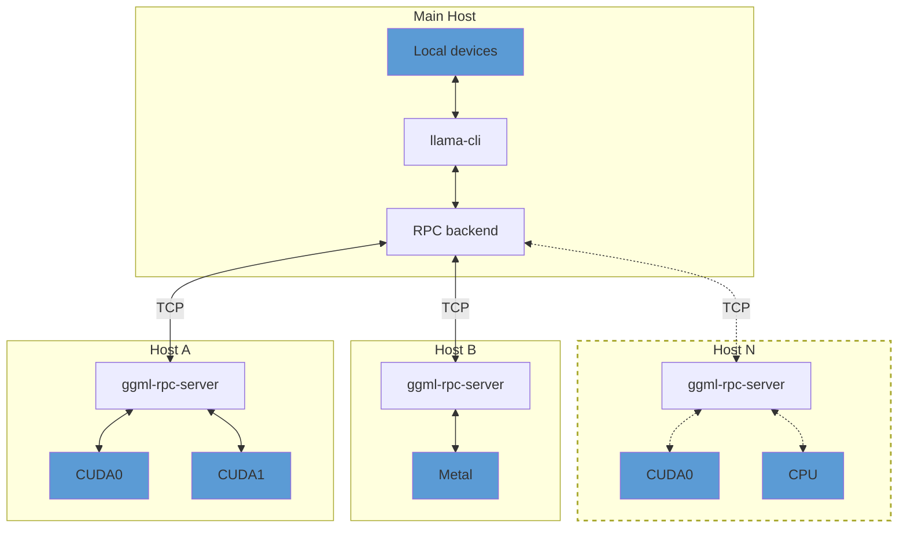

## Overview

> [!IMPORTANT]
> This example and the RPC backend are currently in a proof-of-concept development stage. As such, the functionality is fragile and
> insecure. **Never run the RPC server on an open network or in a sensitive environment!**

The `ggml-rpc-server` allows exposing `ggml` devices on a remote host.
The RPC backend communicates with one or several instances of `ggml-rpc-server` and offloads computations to them.
This can be used for distributed LLM inference with `llama.cpp` in the following way:



By default, `ggml-rpc-server` exposes all available accelerator devices on the host.
If there are no accelerators, it exposes a single `CPU` device.

## Usage

### Remote hosts

On each remote host, build the backends for each accelerator by adding `-DGGML_RPC=ON` to the build options.
For example, to build the `ggml-rpc-server` with support for CUDA accelerators:

```bash
mkdir build-rpc-cuda
cd build-rpc-cuda
cmake .. -DGGML_CUDA=ON -DGGML_RPC=ON
cmake --build . --config Release
```

When started, the `ggml-rpc-server` will detect and expose all available `CUDA` devices:

```bash
$ bin/ggml-rpc-server
ggml_cuda_init: GGML_CUDA_FORCE_MMQ:    no
ggml_cuda_init: GGML_CUDA_FORCE_CUBLAS: no
ggml_cuda_init: found 1 CUDA devices:
  Device 0: NVIDIA GeForce RTX 5090, compute capability 12.0, VMM: yes
Starting RPC server v3.0.0
  endpoint       : 127.0.0.1:50052
  local cache    : n/a
Devices:
  CUDA0: NVIDIA GeForce RTX 5090 (32109 MiB, 31588 MiB free)
```

You can control the set of exposed CUDA devices with the `CUDA_VISIBLE_DEVICES` environment variable or the `--device` command line option. The following two commands have the same effect:
```bash
$ CUDA_VISIBLE_DEVICES=0 bin/ggml-rpc-server -p 50052
$ bin/ggml-rpc-server --device CUDA0 -p 50052
```

### Main host

On the main host build `llama.cpp` with the backends for the local devices and add `-DGGML_RPC=ON` to the build options.
Finally, when running `llama-cli` or `llama-server`, use the `--rpc` option to specify the host and port of each `ggml-rpc-server`:

```bash
$ llama-cli -hf ggml-org/gemma-3-1b-it-GGUF -ngl 99 --rpc 192.168.88.10:50052,192.168.88.11:50052
```

By default, llama.cpp distributes model weights and the KV cache across all available devices -- both local and remote -- in proportion to each device's available memory.
You can override this behavior with the `--tensor-split` option and set custom proportions when splitting tensor data across devices.

### Local cache

The RPC server can use a local cache to store large tensors and avoid transferring them over the network.
This can speed up model loading significantly, especially when using large models.
To enable the cache, use the `-c` option:

```bash
$ bin/ggml-rpc-server -c
```

By default, the cache is stored in the `$HOME/.cache/llama.cpp/rpc` directory and can be controlled via the `LLAMA_CACHE` environment variable.

### RDMA transport

The RPC backend can use RDMA instead of TCP for lower latency and higher throughput. The transport is negotiated during the initial handshake -- no changes to command-line usage are required, and the connection falls back to TCP unless both peers can use RDMA.

Two providers are supported, each enabled by default when its library is found at build time:

- **Linux**: RoCEv2-capable NICs (e.g. Mellanox ConnectX), via `libibverbs`.
- **macOS**: RDMA over Thunderbolt on Apple silicon Macs with Thunderbolt 5, via `librdma`. Requires macOS 26.2 or later, with RDMA enabled once from macOS Recovery via `rdma_ctl enable`. See [TN3205](https://developer.apple.com/documentation/technotes/tn3205-low-latency-communication-with-rdma-over-thunderbolt).

RDMA is point-to-point, so each side uses the local device whose GID matches the address the connection was made on. Connect over the RDMA-capable link -- with Thunderbolt, use the peer's Thunderbolt address in `--rpc`; a connection made over another interface stays on TCP.

To force plain TCP without rebuilding, set `GGML_RPC_NO_RDMA` on either peer:
```bash
$ GGML_RPC_NO_RDMA=1 bin/ggml-rpc-server
```

### Links between servers

When a model is split across several RPC servers, a tensor that one server passes to the next goes over a direct link between the two servers, not through the main host.

The main host opens each link on first use. The receiving server listens on the port the main host connects to plus 1000 (`51052` for a server on `50052`), at the address the main host reached it on, and the sending server connects to it there. That port must be free, and the other RPC servers must be allowed to connect to it. A link uses RDMA when both of its servers can, as the main connection does. `GGML_RPC_NO_RDMA` set on a server keeps that server's links on TCP too; set on the main host, it changes only the main connections.

Each address given to `--rpc` must also reach that server from the other servers. With servers behind tunnels or port mappings, or given as `127.0.0.1` while other servers run on other hosts, set `GGML_RPC_NO_LINK` on the main host. If a link cannot open, the first copy in that direction waits up to 10 seconds, and the copies in that direction then go through the main host.

Links use TCP keepalive. If a link peer's host stops answering, after a power or network loss, a server waiting for data from it gives up after about 150 seconds and then serves its next client. A server sending to it gives up when TCP does, which takes at least 15 minutes with Linux defaults. An idle link also closes after about 150 seconds without network, and the main host then fails at its next copy over that link.

To send all copies through the main host, set `GGML_RPC_NO_LINK` on the main host:
```bash
$ GGML_RPC_NO_LINK=1 llama-cli -hf ggml-org/gemma-3-1b-it-GGUF -ngl 99 --rpc 192.168.88.10:50052,192.168.88.11:50052
```

### Troubleshooting

The `GGML_RPC_DEBUG` environment variable controls the verbosity of the logs emitted by the RPC backend.
It can be set on the server, on the client (e.g. `llama-cli`), or both. Larger values produce more detailed output:

- unset / `0` - disabled (only warnings and errors are printed)
- `1` - high-level events: connections, handshake, buffer allocations, graph computes, cache evictions
- `2` - per-command trace: every RPC message sent/received, tensor transfers, cache hits/misses
- `3` - fine detail: per-command timings, graph node dumps, transport byte counts

Non-numeric values are treated as `1`.

```bash
$ GGML_RPC_DEBUG=1 bin/ggml-rpc-server
```

> [!NOTE]
> The debug levels are emitted as `ggml` debug records, which `llama.cpp` applications drop unless the
> global verbosity threshold is raised. On the client, pass `-lv 5` together with `GGML_RPC_DEBUG`:

```bash
$ GGML_RPC_DEBUG=2 bin/llama-cli -hf ggml-org/gemma-3-1b-it-GGUF -ngl 99 --rpc 192.168.88.10:50052 -lv 5
```

